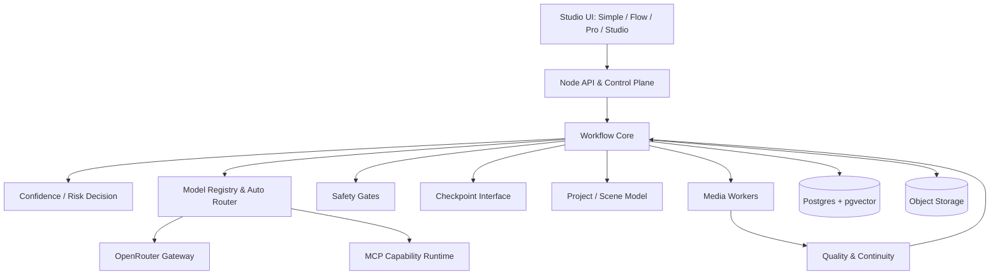

# Foundation Architecture

Principles: Auto routing default; manual locks supported; free-only policy; safety uncertainty is not approval; quality failures trigger targeted repair; checkpoint/resume support; Flow Mode shares core services.
